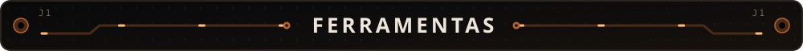
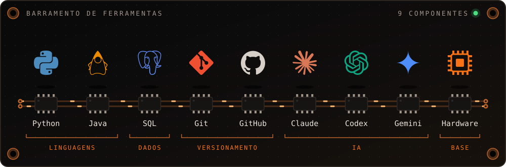
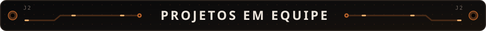
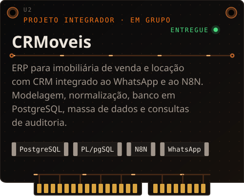
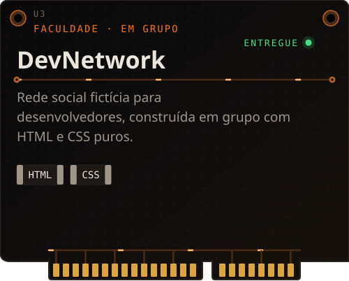
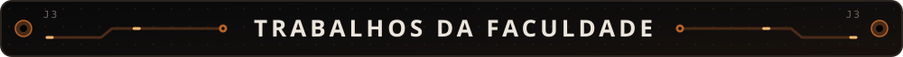
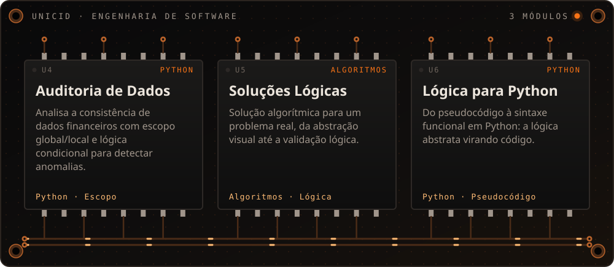
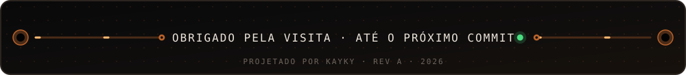

  

  

Estudante de **Engenharia de Software** na UNICID, tenho me direcionado para **Engenharia de Dados**, **uso de IA na resolução de problemas**, **Computação em Nuvem** e **Arquitetura de Bancos de Dados**. Em IA, acompanho de perto a evolução não só de um modelo, mas de todo o ecossistema de agentes.

Minha trajetória tem muito a ver com o desenvolvimento de soluções via código, sempre com uma base prática em tecnologia. Antes de focar em software, atuei na **manutenção e no diagnóstico de hardware e eletrônica**, algo pelo qual ainda tenho muita paixão. Diria que foi o hardware que despertou toda a curiosidade e a paixão que tenho pela tecnologia.

  
  
  

 

  

  

  

  
  

  

  

  
  
  

 

  

